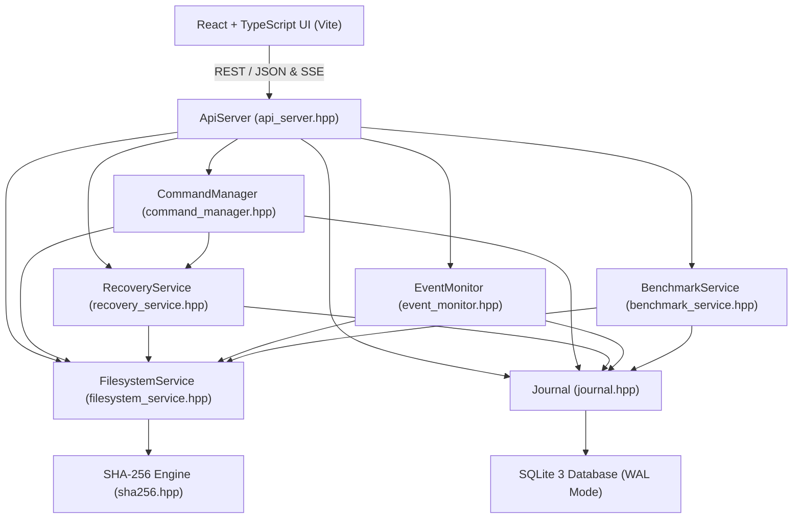

# FileGuard: C++ Header Files & Architecture Reference

This document provides an exhaustive inventory of all header files created and maintained in [`safevault_cpp/include/`](file:///d:/EventDrivenFileSystem/safevault_cpp/include/), documenting each class, structure, and member function, along with their responsibilities in the FileGuard architecture.

---

## 1. Architectural Component Map

---

## 2. Header File Details

### 2.1 `safevault_cpp/include/api_server.hpp`
**Purpose:** Defines the native C++ HTTP server interface powering the FileGuard backend. Built using `httplib`, it provides REST endpoints for file operations, versioning, transactions, benchmarks, and real-time Server-Sent Events (SSE).

- **Class:** `fileguard::ApiServer`
  - `ApiServer(Journal&, FilesystemService&, RecoveryService&, CommandManager&, EventMonitor&, BenchmarkService&)`: Initializes the server and binds subsystem references.
  - `void listen(const std::string& host, int port)`: Starts the HTTP listener on the specified IP and port (default `0.0.0.0:8787`).
  - `void stop()`: Safely halts the HTTP server and releases socket handles.
- **Key Handlers Managed Internally:**
  - `GET /api/health`: Returns server status, undo/redo availability (`can_undo_content`, `can_undo_name`, `can_undo`), and top operation metadata.
  - `POST /api/undo?scope=content|name|all`: Executes scoped undo.
  - `POST /api/redo?scope=content|name|all`: Executes scoped redo.
  - `POST /api/transactions/undo`: Atomically rolls back a batch transaction.
  - `POST /api/transactions/redo`: Atomically reapplies a batch transaction.
  - `GET /api/history/file`: Returns complete file history across renames (revisions, name/location history, operations, and external changes).

---

### 2.2 `safevault_cpp/include/command_manager.hpp`
**Purpose:** Implements the core transactional command execution engine, supporting single and batch file operations, independent undo/redo stacks, and crash recovery.

- **Structures:**
  - `CommandResult`: Holds execution outcome (`success`, `operation_id`, `message`, `error`, `has_conflict`, `conflict_reason`).
  - `BatchItem`: Represents an individual source-destination pair (`source`, `destination`).
  - `BatchProgress`: Tracks batch status (`transaction_id`, `total`, `completed`, `failed`, `current_item`, `status`).
- **Class:** `fileguard::CommandManager`
  - **Single Operations:**
    - `execute_create_file(path, content, transaction_id)`: Creates a new file on disk, logs `INTENT`, computes SHA-256, registers file identity, and logs `EXECUTED`.
    - `execute_create_directory(path, transaction_id)`: Creates a directory with intent logging.
    - `execute_rename(source, dest, transaction_id)`: Renames a file or directory, updates file identity `current_path`, and records a `NameLocationRecord`.
    - `execute_move(source, dest, transaction_id)`: Moves an item across directories with automatic parent directory creation.
    - `execute_copy(source, dest, overwrite, transaction_id)`: Duplicates a file and registers a new revision under the destination file identity.
    - `execute_delete(path, transaction_id)`: Performs a recoverable delete by moving the item to quarantine.
    - `execute_quarantine(path, reason, transaction_id)`: Moves an item to the quarantine vault and stores isolation metadata.
    - `execute_overwrite(path, new_content, transaction_id)`: Takes a pre-image snapshot, overwrites file bytes, takes a post-image snapshot, and logs a revision.
  - **Independent Undo / Redo Stacks:**
    - `undo_content()` / `redo_content()`: Restores pre/post-image snapshot bytes at the file's current path without modifying filenames or directories.
    - `undo_name()` / `redo_name()`: Reverses or reapplies renames/moves without failing on content hash diffs and without altering file bytes. Automatically delegates to `undo_transaction()` / `redo_transaction()` if the operation belongs to a batch.
    - `undo_last()` / `redo_last()`: Global undo/redo primitives.
    - `can_undo()`, `can_redo()`, `can_undo_content()`, `can_redo_content()`, `can_undo_name()`, `can_redo_name()`: Stack status inspection.
  - **Batch Transactions:**
    - `execute_batch_delete(paths, progress_cb)`: Groups deletions into a durable transaction (`tx_del_...`); rolls back completed items on any step failure.
    - `execute_batch_move(items, progress_cb)`: Transactional multi-file move.
    - `execute_batch_copy(items, progress_cb)`: Transactional multi-file copy.
    - `execute_batch_rename(items, progress_cb)`: Transactional multi-file rename.
    - `undo_transaction(tx_id)`: Rolls back all child operations of a transaction in reverse order (`seq DESC`).
    - `redo_transaction(tx_id)`: Reapplies all child operations of a transaction in forward order (`seq ASC`).
  - **Crash Recovery:**
    - `recover_interrupted_operations()`: Scans for operations stuck in `INTENT` state and synchronizes them with the physical filesystem.

---

### 2.3 `safevault_cpp/include/filesystem_service.hpp`
**Purpose:** Provides a secure, sanitized abstraction over the physical filesystem with path validation, jail containment, directory scanning, and drive telemetry.

- **Structures:**
  - `FileItem`: Metadata of a file or directory (`path`, `name`, `extension`, `size_bytes`, `modified_at`, `hash`).
  - `DirectoryListing`: Paginated/listed directory items with folder summary stats (`total_files`, `total_directories`, `total_size_bytes`).
  - `SearchOptions`: Filter parameters for file search (extensions, size bounds, date ranges, content queries).
  - `DriveInfo`: Storage drive metrics (`letter`, `label`, `total_bytes`, `free_bytes`).
  - `DuplicateGroup`: Identifies identical files grouped by `sha256_hash`.
  - `FolderInsights`: Aggregated statistics of folder file types, total size, and top files.
- **Class:** `fileguard::FilesystemService`
  - `std::filesystem::path canonicalize_and_validate(p)`: Resolves symlinks and relative segments (`..`), verifying that the path is inside an approved managed root.
  - `DirectoryListing list_directory(dir_path)`: Scans and returns directory contents.
  - `std::vector<FileItem> search_files(SearchOptions)`: Searches files matching multi-criteria filters.
  - `std::vector<DriveInfo> get_system_drives()`: Enumerates logical drives and free space on the host OS.
  - `FolderInsights get_folder_insights(path)`: Computes file extension breakdowns and size distributions.
  - `void populate_demo_workspace(target_path)`: Generates a realistic sample workspace (`algorithm.cpp`, `dataset.json`, `metrics.csv`, `notes.md`, etc.).

---

### 2.4 `safevault_cpp/include/journal.hpp`
**Purpose:** Manages the durable SQLite WAL database engine, schema lifecycle, entity queries, and the 5-tier identity resolution hierarchy.

- **Key Records:**
  - `FileIdentityRecord`: Assigns permanent identity `id` (`FID-XXXX`), `initial_path`, and mutable `current_path`.
  - `OperationRecord`: Journal entry (`id`, `seq`, `type`, `status`, `source_path`, `dest_path`, `transaction_id`, `details_json`, `is_undone`).
  - `ContentRevisionRecord`: Version record (`id`, `file_identity_id`, `revision_number`, `path`, `sha256_hash`, `snapshot_id`).
  - `NameLocationRecord`: Renames and moves log (`id`, `file_identity_id`, `op_type`, `source_path`, `dest_path`).
  - `ExternalCandidateRecord`: External change record (`id`, `file_identity_id`, `change_type`, `status`, `candidate_hash`).
  - `TransactionRecord`: Batch transaction record (`id`, `type`, `status`, `total_ops`, `completed_ops`, `failed_ops`).
  - `QuarantineEntry`: Quarantined item metadata (`id`, `original_path`, `quarantine_path`, `sha256_hash`, `is_directory`).
- **Class:** `fileguard::Journal`
  - `void init_schema()`: Creates tables and indexes; enables SQLite WAL mode and foreign key constraints.
  - `FileIdentityRecord get_or_create_file_identity(path)`: Resolves or creates a file identity.
  - `std::optional<FileIdentityRecord> find_file_identity_by_path(path)`: Executes 5-tier resolution hierarchy to preserve identity across historical renames.
  - `void update_file_identity_path(fid, new_path)`: Updates the active path of a file identity.
  - `void log_operation_intent(op)` / `update_operation_execution(...)`: Two-phase journal logging.
  - `std::optional<OperationRecord> get_last_undoable_content_operation()` / `get_last_redoable_content_operation()`: Scoped content undo queries.
  - `std::optional<OperationRecord> get_last_undoable_name_operation()` / `get_last_redoable_name_operation()`: Scoped name/location undo queries.
  - `std::vector<OperationRecord> get_operations_for_transaction(tx_id)`: Fetches all child operations belonging to a transaction.
  - `std::vector<ExternalCandidateRecord> get_external_candidates_for_identity(fid)`: Fetches per-file external change archives across all historic renames.

---

### 2.5 `safevault_cpp/include/recovery_service.hpp`
**Purpose:** Coordinates file snapshots, version restoration, quarantine vault isolation, and cryptographic integrity verification.

- **Class:** `fileguard::RecoveryService`
  - `QuarantineEntry quarantine_item(path, op_id)`: Moves an item to the quarantine vault with SHA-256 verification.
  - `bool restore_quarantined_item(qid, overwrite, custom_dest)`: Restores a file or folder from quarantine back to its original location.
  - `bool permanently_delete_quarantined_item(qid)`: Purges an item from quarantine disk storage.
  - `VersionRecord create_snapshot(path, op_id)`: Captures an immutable pre-image or post-image snapshot in `storage/snapshots/`.
  - `bool restore_snapshot_to(version_id, target_dest, backup_current)`: Replaces file bytes with a prior snapshot version.
  - `bool verify_integrity(path, expected_hash)`: Compares the on-disk SHA-256 against the recorded hash.
  - `StorageUsage get_storage_usage()`: Returns disk space used by snapshots and quarantine.

---

### 2.6 `safevault_cpp/include/event_monitor.hpp`
**Purpose:** Background event monitoring subsystem that ingests filesystem change notifications, suppresses self-mutation feedback loops, debounces bursts, and classifies external changes.

- **Class:** `fileguard::EventMonitor`
  - `bool start(dir_to_watch)`: Starts background directory watching thread.
  - `void stop()`: Stops monitoring and drains event queues.
  - `WatcherStatus get_status()`: Returns monitoring health, events captured, and overflow count.
  - `void notify_app_mutation(path)`: Registers an app-initiated file write timestamp to prevent false-positive external alerts.
  - `void register_expected_mutation(path, old_path, ttl_ms)`: Registers planned mutations with TTL.
  - `static std::string normalize_path_key(path)`: Canonicalizes path keys for case-insensitive cross-subsystem matching.

---

### 2.7 `safevault_cpp/include/benchmark_service.hpp`
**Purpose:** OS Performance Laboratory engine that benchmarks kernel write latencies, watcher throughput, concurrency speedups, and crash recovery.

- **Class:** `fileguard::BenchmarkService`
  - `JournalOverheadResult run_journal_overhead_benchmark(ops_count)`: Experiment A — compares raw filesystem write latency vs journaled write latency; calculates median ($p_{50}$), $p_{95}$, and $p_{99}$.
  - `WatcherVsPollingResult run_watcher_benchmark(file_count)`: Experiment B — measures event notification latency and debounce efficiency under rapid file bursts.
  - `ScanBenchmarkResult run_scan_benchmark(depth, files_per_dir, threads)`: Experiment C — benchmarks concurrent directory traversal vs sequential scan, verifying count/byte correctness.
  - `CrashRecoveryResult run_crash_recovery_benchmark(interrupted_ops)`: Experiment D — simulates an aborted batch write and measures crash recovery replay speed.

---

### 2.8 `safevault_cpp/include/sha256.hpp`
**Purpose:** High-performance, self-contained cryptographic SHA-256 hashing engine.

- **Functions:**
  - `std::string sha256_bytes(const uint8_t* data, size_t len)`: Hashes raw byte buffer.
  - `std::string sha256_buffer(const std::vector<uint8_t>& buf)`: Hashes vector buffer.
  - `std::string sha256_string(const std::string& str)`: Hashes ASCII/UTF-8 string.
  - `std::string sha256_file(const std::filesystem::path& path)`: Computes hash of a disk file using buffered 64KB block reads.

---

### 2.9 `safevault_cpp/include/watch.hpp` & `safevault_cpp/include/etw_watcher.hpp`
**Purpose:** Low-level Windows OS change notification backends.

- `watch.hpp`: Defines `void watch(root, db_path)` for terminal CLI directory monitoring.
- `etw_watcher.hpp`: Defines `EtwWatcher` for Event Tracing for Windows (kernel-level trace consumer).

---

### 2.10 `safevault_cpp/include/fileguard_tests.hpp`
**Purpose:** Automated test runner entry point.

- `int run_all_tests()`: Executes all 21 unit, integration, and regression tests, returning 0 on full success.

